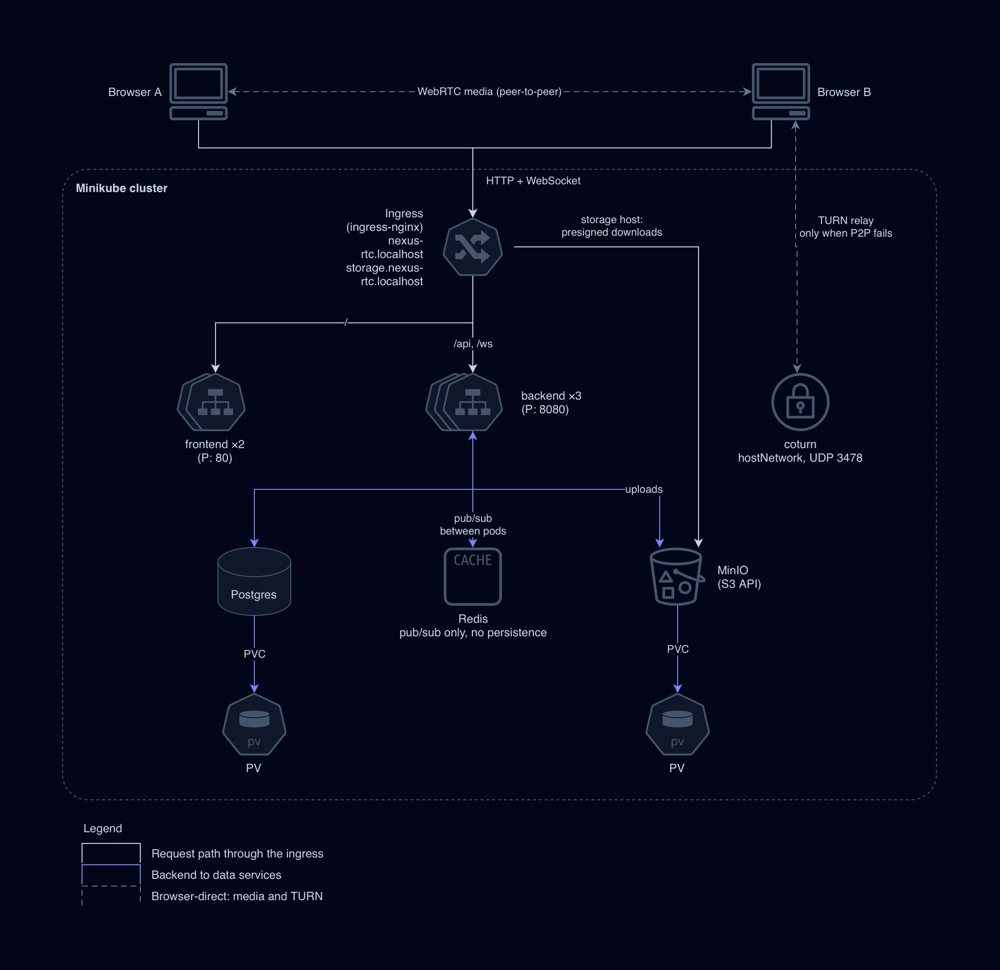
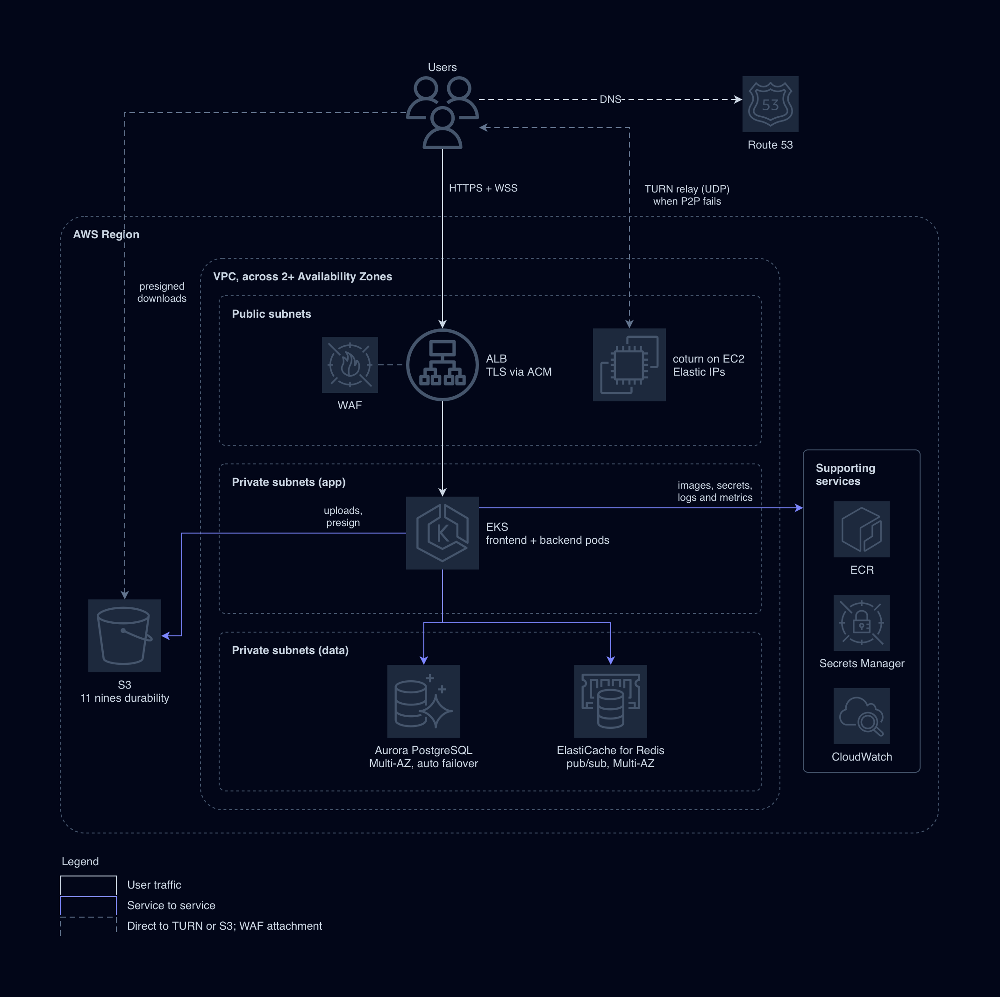

# NexusRTC

A Discord-style real-time chat and calling app: text channels, file attachments, and 1:1 video calls with screen sharing. It runs as horizontally scaled Spring Boot pods on Kubernetes, with Redis pub/sub carrying messages between pods.

> **Status: work in progress.** The architecture is in place, but the app has known security and correctness issues, listed in the [Known issues](#known-issues) section with planned fixes. Don't deploy it anywhere public in its current state.

**Stack:** Java 17 · Spring Boot (Web, WebSocket/STOMP, Security, Data JPA) · PostgreSQL + Flyway · Redis · MinIO (S3 API) · React + TypeScript + Vite + Tailwind · WebRTC · coturn · Kubernetes (Minikube) · Jenkins · Trivy

---

## What works today

- Sign-up and login with JWT authentication (REST, plus a STOMP `CONNECT` header for WebSockets).
- Creating, joining, leaving and deleting text channels. Message history is persisted in PostgreSQL.
- Live messaging across multiple backend replicas. A message sent to pod A reaches users connected to pod B through Redis pub/sub.
- Notifications for messages in channels you aren't currently viewing.
- File attachments stored in MinIO, served through presigned URLs.
- 1:1 video calls with mute, camera toggle and screen sharing (`replaceTrack`, no renegotiation). Calls start with the mic and camera disabled. ICE candidates that arrive before the remote description are queued. **Calling only works reliably with exactly two users online** (see C1–C3).
- Light and dark themes.
- Kubernetes manifests for every component, and a Jenkins pipeline with test, build, deploy and image-scan stages. The deploy stage is currently broken (see P1).

---

## Architecture



A single hostname (`nexus-rtc.localhost`) serves everything through the ingress:

| Path | Backend |
|---|---|
| `/ws` | Spring Boot STOMP endpoint |
| `/api` | Spring Boot REST API |
| `/` | nginx serving the React build |

ingress-nginx matches the longest prefix regardless of rule order. Cookie affinity is configured, but nothing in the app depends on it: authentication is stateless JWT and Redis handles cross-pod delivery, so it is slated for removal (I2).

### Cross-pod messaging

With `replicas: 3`, users in the same channel can be connected to different pods. Each pod uses Spring's in-memory STOMP broker for its own sockets, and Redis pub/sub connects the pods:

1. **Connect.** The client opens a STOMP connection and sends its JWT in the `CONNECT` frame. A `ChannelInterceptor` validates it and attaches a `Principal` to the session. Invalid tokens are not yet rejected (S5).
2. **Send.** The client sends to `/app/chat.sendMessage/{channelId}`. `ChatController` saves the message to PostgreSQL and publishes it to the Redis channel `app:channel:{channelId}`. Join events use `/app/chat.addUser/{channelId}` and follow the same path without being saved.
3. **Fan-out.** Every pod subscribes to the pattern `app:channel:*`, so every pod receives every message.
4. **Local delivery.** `RedisMessageSubscriber` forwards each message to `/topic/channels/{channelId}` on its own broker, which pushes it to that pod's subscribers.
5. **Signaling and notifications.** WebRTC signals use the Redis topic `nexus-rtc-signaling` and are delivered to `/topic/public`, which every client subscribes to. This is a broadcast, which is the root of C1–C4. Notifications use `app-system-notifications` and are delivered to `/queue/notifications/{username}`.

This is the standard backplane pattern. Its cost is one delivery per pod per message, and Redis pub/sub is at-most-once: a pod or client that is disconnected when a message is published never sees it (R2).

### Calling

Calls are **1:1 peer-to-peer**, using one `RTCPeerConnection` per call. STUN handles most NAT traversal; coturn relays media when a direct path fails.

Group calls would need either a mesh (N−1 connections per client, practical up to about 4 people) or an SFU such as LiveKit, mediasoup or Janus. The Discord model is also different: voice channels are persistent rooms you join, not calls you place. Moving to that model is on the roadmap.

### Storage

- **Database.** Hibernate runs with `ddl-auto: validate`; Flyway migrations own the schema.
- **Attachments.** `StorageFacade` uploads files to MinIO under a UUID-prefixed key. Message history and live messages carry a presigned GET URL that expires after 2 hours. *Current gaps:* the MinIO init job makes the bucket publicly readable, which defeats the presigned URLs, and the server presigns any key a client sends (S7).

### Design patterns

- **Strategy:** `NotificationStrategy`, with `WebSocketNotificationStrategy` as the only implementation. It leaves room for push or email delivery.
- **Facade:** `StorageFacade` wraps the MinIO/S3 SDK, so switching to AWS S3 is a configuration change.
- **Publish/subscribe:** STOMP topics for clients, and Redis pub/sub between pods.

---

## CI/CD

The Jenkins pipeline (`Jenkinsfile`) runs inside the cluster (`k8s/jenkins-infra.yml`):

1. **Validate (parallel).** Backend `mvn test` against throwaway Postgres and Redis containers, and a frontend `tsc --noEmit` type check.
2. **Build (parallel).** `linux/arm64` backend and frontend images.
3. **Deploy.** `kubectl apply` plus `rollout restart` for the backend and frontend.
4. **Scan.** Trivy (ARM64 `.deb`) reports HIGH and CRITICAL vulnerabilities.

**Current state:** the pipeline builds `rtc-*` images while the manifests use `nexus-rtc-*`, so the deploy stage targets deployments that don't exist (P1). The scan also runs after deploy and can't fail the build (P3). Until those are fixed, deploy with the manual Kubernetes steps below.

---

## Running locally

### Kubernetes (Minikube) — recommended

**Prerequisites:** Docker Desktop, Minikube, kubectl, and these entries in `/etc/hosts` pointing to `127.0.0.1`:
`nexus-rtc.localhost storage.nexus-rtc.localhost storage-ui.nexus-rtc.localhost jenkins.localhost`

```shell
# 1. Start Minikube with the ingress addon, then run the tunnel in a separate terminal
minikube start
minikube addons enable ingress
minikube tunnel

# 2. Build the images and load them into Minikube
docker build -t nexus-rtc-backend:latest ./backend
docker build -t nexus-rtc-frontend:latest ./frontend
minikube image load nexus-rtc-backend:latest
minikube image load nexus-rtc-frontend:latest

# 3. Point the backend at your ingress controller's ClusterIP (see B7)
kubectl get svc -n ingress-nginx ingress-nginx-controller
#    ...then put its CLUSTER-IP into hostAliases in k8s/backend-deployment.yml

# 4. Deploy everything
kubectl apply -f k8s
```

| URL | Service |
|---|---|
| `http://nexus-rtc.localhost` | App (frontend, `/api`, `/ws`) |
| `http://storage-ui.nexus-rtc.localhost` | MinIO console |
| `http://storage.nexus-rtc.localhost` | MinIO S3 API |
| `http://jenkins.localhost` | Jenkins |

**TURN:** `coturn/turnserver.conf` uses `external-ip=10.0.0.58` and the frontend uses `turn:localhost:3478`. Calls between two browsers on one machine work; calls from other machines need both values set to an address those machines can reach (C7).

### Docker Compose — currently broken

`docker-compose.yml` doesn't work as written (I7):
- the backend looks for Redis at `redis`, but the service is named `nexus-rtc-redis`;
- the frontend image is built for the ingress URLs, and Compose has nothing routing `/api` and `/ws` to the backend;
- nothing creates the MinIO bucket.

Fixing Compose is on the Phase 2 list.

### Tests

```bash
cd backend && mvn test           # needs Postgres and Redis reachable at the configured addresses
cd frontend && npm ci && npx tsc --noEmit
```

Backend tests currently cover sign-up only, and depend on the Docker bridge addresses used in Jenkins (B8). Testcontainers is planned so `mvn test` works anywhere.

---

## Roadmap

| Phase | Focus | Items |
|---|---|---|
| 1 | Security | S1–S8: identity from the JWT everywhere, inbound DTOs, reject anonymous `CONNECT`, STOMP destination authorization, private bucket with authorization-checked downloads, secrets from the environment |
| 2 | Runs anywhere | I7, P1–P3, C1–C5: working Compose setup, fixed pipeline, signaling routed to the callee with a call id and accept/decline, screen-share track fixes |
| 3 | Real-time correctness | R1–R5, B8: one shared STOMP connection, cursor pagination, backfill after reconnect, async notifications, Testcontainers authorization tests |
| 4 | Production readiness | B9, I1–I6, S9: Actuator probes, graceful shutdown, ephemeral TURN credentials, Gateway API, MinIO replacement, load test, demo video |

### Planned: targeted notification routing

Today every pod receives every notification and drops the ones for users it doesn't host. The plan is a session directory in Redis:

1. Each pod learns its name through the Downward API (`metadata.name` → `K8S_POD_HOSTNAME`).
2. On connect, a pod adds itself to a Redis set `sessions:{username}` with a TTL it refreshes on a heartbeat. It's a set because one user can have tabs connected to several pods. On disconnect, the pod removes itself.
3. Notifications are published only to `notifications:{pod}` for each pod in the user's set. If the set is empty, the user is offline and the notification is stored for later instead of dropped.

Edge cases to handle: stale entries after a pod crash (the TTL covers these), and a reconnect that races a notification (the client backfills unread state on connect).

The larger cost today is elsewhere, though. Notification dispatch publishes once per channel member, synchronously, after an N+1 member query (R5). Fixing that comes first.

### AWS migration path



1. **EKS.** Reuse the manifests, with the AWS Load Balancer Controller (ALB, ACM certificates) or a Gateway API implementation in place of ingress-nginx. Sticky sessions aren't needed (I2).
2. **Aurora PostgreSQL** (Multi-AZ) in place of the in-cluster Postgres.
3. **S3** in place of MinIO. S3 is designed for 99.999999999% (11 nines) durability. Add lifecycle rules for orphaned uploads (B6), and CloudFront for delivery.
4. **ElastiCache for Redis.** ElastiCache is regional; Multi-AZ with automatic failover covers zone outages, and cross-region needs Global Datastore. In cluster mode, use sharded pub/sub (Redis 7+) so pub/sub traffic isn't broadcast to every shard.
5. **TURN.** A dedicated coturn fleet with public IPs, `turns:` on 443, and short-lived credentials. Or a managed TURN service.

---

## Design decisions

- **STOMP over raw WebSockets.** Topics, subscriptions and user destinations come built in, and Spring integrates them with security. The cost is more framing overhead than a custom binary protocol.
- **Redis pub/sub over a STOMP broker relay.** Redis was already needed and is simple to run. A RabbitMQ relay (`enableStompBrokerRelay`) would provide cross-node topics and user destinations natively, and would replace the hand-written Redis bridge and its payload-based routing (R6). It's the likely next step if delivery guarantees matter more than operational simplicity.
- **1:1 P2P calls instead of an SFU.** No media server to run, at the cost of not scaling past a handful of participants.

---

## Known issues

IDs are referenced from `KNOWN ISSUE (...)` comments in the code. Severity: **Critical** = exploitable or loses data, **High** = broken for normal use, **Medium** = scaling or robustness, **Low** = cleanup. All items are open.

### Security

| ID | Severity | Issue | Planned fix |
|---|---|---|---|
| S1 | Critical | REST endpoints take `userId` from the request (`?userId=`, `/user/{userId}`, `creatorId`), not the JWT. Anyone can read any channel's history or join, leave and list channels as any user, and IDs are sequential. | Use `@AuthenticationPrincipal` and remove the `userId` parameters. |
| S2 | Low | Defensive gap, not a login bypass: the server checks credentials and always sets the `userId` claim. If the claim were ever missing, `Login.tsx` would store `"undefined"` and `Chat.tsx` would silently use user id 1. | Treat a missing claim as an error, and remove the `\|\| 1` fallback. |
| S3 | Critical | The STOMP chat payload is bound to the JPA entity. Clients set `sender` (impersonation) and `timestamp`, and a supplied `id` makes `save()` overwrite an existing message. | Inbound DTO; sender from the `Principal`; build the entity server-side. |
| S4 | Critical | No authorization on STOMP `SUBSCRIBE` or `SEND`: anyone can subscribe to any `/topic/channels/{id}` or `/queue/notifications/{username}`, and clients can `SEND` straight to `/topic/...`, bypassing the controllers. The membership check in `sendMessage` is commented out. | Inbound interceptor that checks destinations against membership and denies client `SEND` to broker prefixes; `convertAndSendToUser` for notifications. |
| S5 | High | A `CONNECT` without a valid token is accepted as an anonymous session, and signaling handlers then throw an NPE. | Reject the `CONNECT` in the interceptor. |
| S6 | High | Any authenticated user can delete any channel. There is no ownership concept; the UI only hides the button. | Add an owner and roles; check them on delete. |
| S7 | Critical | Attachments: the bucket is set to public read; the server presigns any client-supplied key; there's no content-type allowlist; the client's `Content-Type` is served back (stored XSS via HTML uploads); the original filename is unsanitized; Spring's 1 MB multipart default makes larger uploads fail despite the 50 MB ingress limit. | Private bucket; record uploads with their owner; authorization-checked `/api/attachments/{id}` that redirects to a fresh presigned URL; type allowlist; explicit size limits. |
| S8 | High | The JWT secret is hardcoded in `JwtUtils`. `app.jwtSecret` and the Kubernetes `jwt-secret` are never read, and dev secrets are committed in several places. | Inject via `@Value` from a Secret; use sealed-secrets or SOPS; rotate. |
| S9 | High | TURN credentials are static and compiled into the JS bundle (an open relay), and coturn has no `denied-peer-ip` rules while running with `hostNetwork`, so clients can relay into the node network. | `use-auth-secret` with short-lived credentials issued by the backend; deny private ranges; `no-multicast-peers`. |
| S10 | Medium | JWT in `localStorage` (readable by any XSS), 24h expiry, no refresh or revocation, no route guard on `/chat`, no 401 handling. | Short-lived access token plus httpOnly refresh cookie; route guard; axios 401 interceptor. |
| S11 | Medium | No rate limiting on login, sign-up, messages, uploads or channel creation. A duplicate email at sign-up returns 500. | Bucket4j or gateway rate limits; `existsByEmail` check. |
| S12 | Low | `@CrossOrigin("*")` on controllers alongside a stricter security CORS config with credentials. | Keep one CORS configuration. |

### Real-time messaging

| ID | Severity | Issue | Planned fix |
|---|---|---|---|
| R1 | High | Two STOMP connections per user (`useChat` and `MainChat`). `MainChat` tears its connection down and reconnects on every channel switch. | One shared connection; swap subscriptions. |
| R2 | Medium | Messages are saved before they're broadcast, so nothing is lost from history. But a client whose socket drops and reconnects (including during every rollout) doesn't re-fetch history, so messages sent during the gap don't appear until the user switches channels or reloads. Messages sent between the history fetch and the subscription are missed the same way. | On every connect, fetch messages after the last seen id. |
| R3 | Medium | No client message ids, acks or idempotency. Ordering uses `LocalDateTime.now()` (server-local time, ties possible) and can differ across pods. | Client ids plus server acks; order by id or a snowflake id; `timestamptz`. |
| R4 | High | Opening a channel loads its entire history and presigns every attachment. | Cursor pagination on `(channel_id, id)` with infinite scroll. |
| R5 | Medium | Notification dispatch runs synchronously in the send path: an N+1 member query and one Redis publish per member, delivered to every pod. It includes users who are viewing the channel or offline, and offline notifications are lost. | Async dispatch; skip active viewers; persist unread state; targeted routing (see Roadmap). |
| R6 | Medium | `RedisMessageSubscriber` picks the destination by checking which JSON fields a payload has. | Route by Redis channel name, or move to a broker relay. |
| R7 | Low | A JOIN is broadcast on every connect, reconnect and channel switch; LEAVE is never sent; there's no online list or typing indicator. | Presence driven by connect/disconnect events, with a Redis-backed online set. |
| R8 | Medium | No WebSocket message size, send-time or buffer limits; no broker heartbeats configured. | Configure transport limits and heartbeats. |
| R9 | Medium | The sidebar polls two endpoints every 5 seconds per user. | Push channel create and delete events over the WebSocket. |

### Calling

| ID | Severity | Issue | Planned fix |
|---|---|---|---|
| C1 | Critical | Signals are broadcast to `/topic/public` and `receiver` is ignored. Every other online user's browser turns on its camera and auto-answers any offer; there's no ring, accept or decline. | Route with `convertAndSendToUser(receiver, ...)`; add a ringing flow. |
| C2 | High | The call target is the hardcoded string `target-user`. | Pick the callee from the channel's members. |
| C3 | High | No call id: one HANGUP ends every call, and candidates from other calls are applied. | Call id on every signal; filter on it. |
| C4 | High | SDP and ICE candidates (local and public IPs) are visible to every connected user. | Fixed by C1. |
| C5 | High | Starting a screen share stops the microphone track being sent, so the peer loses your audio. Stopping a share leaks a new audio track and always restores with the camera off (stale `isVideoOff`). | Stop only the camera video track; reuse the existing audio track; read state through refs. |
| C6 | Medium | No handling for connection-state changes, ICE restarts, glare or `getUserMedia` rejection (`isCalling` stays stuck). | State handlers with UI feedback; `try`/`finally` around call setup. |
| C7 | Medium | The TURN URL is `localhost` in the client and `external-ip` is a private LAN IP; TLS on 5349 has no certificates. | Configure from the environment; `turns:` with real certificates. |

### Backend and data

| ID | Severity | Issue | Planned fix |
|---|---|---|---|
| B1 | Medium | `ChatMessage` serves as entity, inbound payload, Redis payload and response, with `@Transient` response fields. | Separate request and response DTOs. |
| B2 | Low | `NotificationController` is a `@Service`. | Rename to `NotificationService`. |
| B3 | Low | Channel creation checks then inserts (a race that surfaces as a 500); error responses have no body. | Catch the constraint violation; return problem-details bodies. |
| B4 | Medium | `baseline-on-migrate: true` can hide schema drift. | Disable it outside local development. |
| B5 | Medium | `show-sql` and DEBUG/TRACE logging in every environment; DB credentials in `application.yml`. | Spring profiles; credentials from the environment only. |
| B6 | Low | Storage leak, not a display bug. A file that is uploaded but never sent as a message (the WebSocket send fails, or the upload API is called directly) stays in the bucket with nothing pointing to it. Deleting a channel removes its messages from the database but not their files. | Delete objects with their channel; a cleanup job for unreferenced uploads. |
| B7 | Medium | Presigned URLs change on every load (no caching) and break in tabs open longer than 2h. Their host relies on `hostAliases` pinned to one cluster's ingress ClusterIP. | Stable `/api/attachments/{id}` redirect route (see S7). |
| B8 | High | Tests cover sign-up only, and depend on Jenkins Docker bridge IPs. | Testcontainers; authorization tests for every endpoint and destination. |
| B9 | Medium | TCP liveness and readiness probes with long initial delays; no Actuator. | `startupProbe` plus Actuator liveness and readiness groups. |

### Frontend

| ID | Severity | Issue |
|---|---|---|
| F1 | Low | `import.meta.env.NODE_ENV` doesn't exist in Vite, so debug logging never runs (use `import.meta.env.DEV`). Verbose `console.log` telemetry ships in production builds. |
| F2 | Medium | `useChannels` recreates its polling interval on every channel switch. The active channel is restored from `localStorage` without checking membership. |
| F3 | Low | Snackbar timeouts aren't cleared; messages use `key={index}`; logout calls `localStorage.clear()` (losing the theme); the register page can render an error object, which crashes React. |
| F4 | Low | Inline SVGs use the wrong namespace (`http://w3.org`) while `lucide-react` is already installed; icon-only buttons lack `aria-label`s; the "Cluster Sync: Online" indicator is static. |
| F5 | Medium | `VITE_*` URLs are baked in at build time, so one image can't move between environments; `.env.development` points at `:8080`, which isn't in the CORS or WebSocket allowed origins for the Vite dev server on `:5173`. |
| F6 | Medium | Plain `http`/`ws` only works because browsers treat `*.localhost` as a secure context. Any real hostname needs HTTPS for `getUserMedia`. |

### Infrastructure

| ID | Severity | Issue | Planned fix |
|---|---|---|---|
| I1 | High | ingress-nginx was retired in March 2026 and no longer receives security fixes. The `websocket-services` annotation has no effect in it, and `kubernetes.io/ingress.class` is deprecated. | Migrate to Gateway API (e.g. Envoy Gateway). |
| I2 | Low | Cookie affinity is configured but not needed, and it unbalances long-lived sockets. | Remove it, and confirm with a multi-pod test. |
| I3 | High | Redis is a single replica with no auth, persistence or probes. If it restarts, cross-pod delivery stops while messages keep saving. | Auth, probes, Sentinel or a managed service; alerting. |
| I4 | Medium | No graceful shutdown or connection draining, and clients reconnect after a fixed 5s with no jitter, so every rollout drops all sockets at once. | `server.shutdown=graceful`, `preStop`, jittered backoff. |
| I5 | Medium | No NetworkPolicy, PodDisruptionBudget, HPA, `securityContext` or namespace; Postgres is a Deployment on a hostPath volume. | Add them; StatefulSet or a managed database. |
| I6 | Medium | The MinIO console and API are exposed through the ingress with dev credentials. MinIO's community edition is in maintenance mode and no longer publishes images, so the pinned images won't get fixes. | Don't expose the console; evaluate SeaweedFS or Garage, or S3 with LocalStack for dev. |
| I7 | High | Docker Compose doesn't run (see [Docker Compose](#docker-compose--currently-broken)); coturn is `latest` there; `depends_on` has no health checks. | Fix the host names; add an nginx proxy for `/api` and `/ws`; add a bucket init service. |

### CI/CD

| ID | Severity | Issue | Planned fix |
|---|---|---|---|
| P1 | High | Image and deployment names don't match (`rtc-*` vs. `nexus-rtc-*`), so the deploy stage fails, and would restart pods on stale images even if it didn't. | Consistent names; `kubectl set image` with a SHA tag. |
| P2 | Low | The Jenkins image is multi-arch, so on Apple Silicon it runs as arm64, but the pod downloads the **amd64** `kubectl`. It works only through Docker Desktop's x86 emulation and fails with `exec format error` on a native arm64 node. | Pick the binary from `uname -m`. |
| P3 | High | Trivy runs after deploy with `\|\| true`. | Scan before deploy; fail on CRITICAL. |
| P4 | Medium | Mutable `:latest` tags with `IfNotPresent`, no registry, no rollback path. | Git-SHA tags, a local registry, and Kustomize or Helm. |
| P5 | Critical | The Jenkins pod runs privileged as root with `docker.sock` and `cluster-admin`, so any pipeline change controls the node and cluster. | Kaniko or rootless BuildKit; a namespaced deploy Role. |
| P6 | Low | Unused `CLUSTER_TOKEN`; only two manifests are applied (ConfigMap and Secret changes never deploy); `node-26` in CI vs. `node:20` in the Dockerfile; `npm install` instead of `npm ci`; no lint or frontend tests; fixed container names break concurrent builds; `sleep 5` instead of readiness checks. | Clean up the pipeline. |

### Not yet measured

There are no load-test results yet. The planned test is k6 against `/ws`: messages per second and p99 delivery latency with 1 vs. 3 backend pods. Results will be added here.
